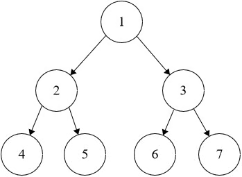

# Binary Tree Level Order Traversal
https://neetcode.io/problems/level-order-traversal-of-binary-tree/question?list=blind75

## Topics
Tree, Breadth-First Search, Binary Tree

## Recommended Time & Space Complexity
You should aim for a solution with O(n) time and O(n) space, where n is the number of nodes in the given tree. 

## Solutions
### Solution 1: BFS [optimal]
ex:- 

[[1], [2, 3], [4, 5, 6, 7]]

main idea: using Breadth First Search

- use a queue to hold the elements at a level
- start with the root
- add root element to the queue
- when you go the next level, you should pop the element
- once removed, add the children to the queue
- continue this until you go through all the levels

#### Complexity
- Time: $O(n)$
- Space: $O(n)$