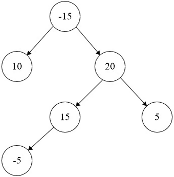

# Kth Smallest Integer in BST
https://neetcode.io/problems/kth-smallest-integer-in-bst/question?list=blind75

## Topics
Dynamic Programming, Tree, Depth-First Search, Binary Tree

## Recommended Time & Space Complexity
You should aim for a solution with O(n) time and O(n) space, where n is the number of nodes in the given tree.  

## Solutions
### Solution 1: DFS [optimal]
ex:- 

Input: root = [-15,10,20,null,null,15,5,-5]
Output: 40
Explanation: The path is 15 -> 20 -> 5 with a sum of 15 + 20 + 5 = 40.

main idea: using dynamic programming and DFS

- we start with the root
- and we go to the left subtree and continue until we get to the left most node
- then go to the right sub tree
- repeat the above until we find the node with the maximum value to begin
- so we are solving each node's childrens, this will solve it for that place
- continue the above for the rest 

#### Complexity
- Time: $O(n)$
- Space: $O(n)$