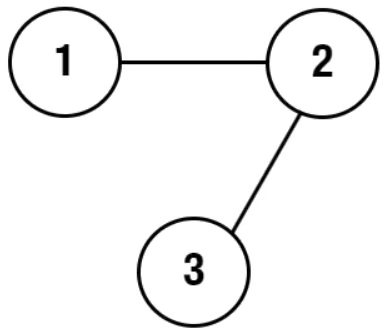

# Clone Graph
https://neetcode.io/problems/clone-graph/question?list=blind75

## Topics
Hash Table, Depth-First Search, Breadth-First Search, Graph

## Recommended Time & Space Complexity
You should aim for a solution with O(V + E) time and O(V) space, where V is the number of vertices and E is the number of edges in the given graph. 

## Solutions
### Solution 1: using dfs with a hashmap [optimal]

Input: adjList = [[2],[1,3],[2]]

Output: [[2],[1,3],[2]]

- starting with the given node, create a copy of this node
- map the old given node to the new copy node in the hash map
- now go to a neighbour, and do the above procedure for it aswell
- now connect the two copied nodes
- if we get to a node that has alredy been mapped
- we dont need to create it again, we only need to create the edge

#### Complexity
- Time: $O(V + E)$
- Space: $O(V)$