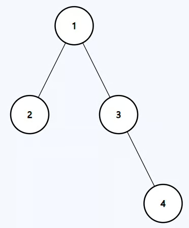

# Construct Binary Tree from Preorder and Inorder Traversal
https://neetcode.io/problems/binary-tree-from-preorder-and-inorder-traversal/question?list=blind75

## Topics
Array, Hash Table, Divide and Conquer, Tree, Binary Tree

## Recommended Time & Space Complexity
You should aim for a solution with O(n) time and O(n) space, where n is the number of nodes. 

## Solutions
### Solution 1: recurrsive DFS [optimal]
ex:- 

Input: preorder = [1,2,3,4], inorder = [2,1,3,4]
Output: [1,2,3,null,null,null,4]

main idea: using Divide and conquer

- create the root node by using the preorder element, pr[0]
- now every element before the pr[0] for inorder will be the left subtree, and after will belong to the right subtree
- go to the next element in the preorder
- check the inorder array, and find the next node using previous logic
- this way, we can crete the left and right

- the element in preorder array is taken as mid
- the elemtents before mid in the inorder array
- now go to the left sub tree by going over the preorder array
- once all them are done, do the same for right subtree

#### Complexity
- Time: $O(n)$
- Space: $O(n)$