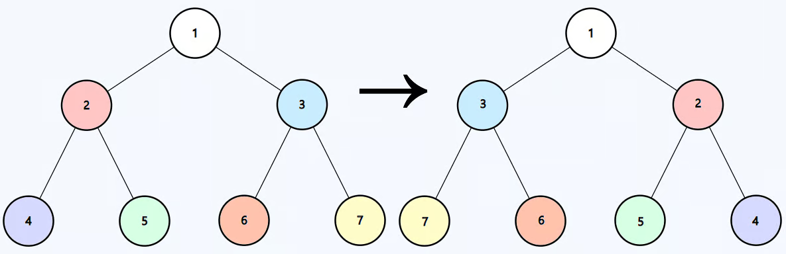

# Invert Binary Tree
https://neetcode.io/problems/invert-a-binary-tree/question?list=blind75

## Topics
Tree, Depth-First Search, Breadth-First Search, Binary Tree

## Recommended Time & Space Complexity
You should aim for a solution with O(n) time and O(n) space, where n is the number of nodes in the tree. 

## Solutions
### Solution 1: DFS [optimal]
ex:- 

Input: root = [1,2,3,4,5,6,7]

Output: [1,3,2,7,6,5,4]

main idea: using DFS and recurrsion

- using dfs we can go to the lowest node that has children
- start with the top node root
- we then swap the places of left and right
- and then we iteratively go to the lower layer
- do this until we reach the leaf nodes

#### Complexity
- Time: $O(n)$
- Space: $O(n)$