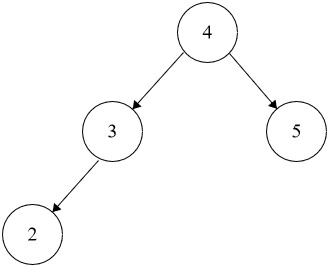

# Kth Smallest Integer in BST
https://neetcode.io/problems/kth-smallest-integer-in-bst/question?list=blind75

## Topics
Tree, Depth-First Search, Binary Search Tree, Binary Tree

## Recommended Time & Space Complexity
You should aim for a solution as good or better than O(n) time and O(n) space, where n is the number of nodes in the given tree.    

## Solutions
### Solution 1: DFS [optimal]
ex:- 

Input: root = [4,3,5,2,null], k = 4
Output: 5

main idea: using depth first search for in order traversal

- initialize a queue to hold th enodes
- go to the left most node
- pop it, count the pop
- if its not k, go to the previous node
- pop it, go to the right node
- continue until you pop all the nodes

#### Complexity
- Time: $O(n)$
- Space: $O(n)$