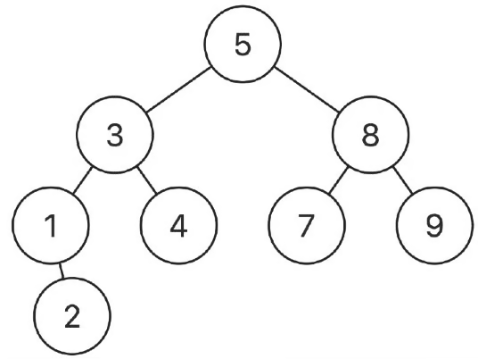

# Lowest Common Ancestor in Binary Search Tree
https://neetcode.io/problems/lowest-common-ancestor-in-binary-search-tree/question?list=blind75

## Topics
Tree, Depth-First Search, Binary Search Tree, Binary Tree

## Recommended Time & Space Complexity
You should aim for a solution as good or better than O(h) time and O(h) space, where h is the height of the given tree. 

## Solutions
### Solution 1: checking subtrees [optimal]
ex:- 

main idea: if its the lowest ancestor if p, q are in different subtrees

- start from the root
- check if p and q are less than root, if not go to the left subtree
- check if p and q are larger than root, if not go to the right subtree
- continue this process until both conditions are true, or you traverse the entire tree
- once they are both false, you will find the lowest common ancestor

#### Complexity
- Time: $O(h)$
- Space: $O(1)$