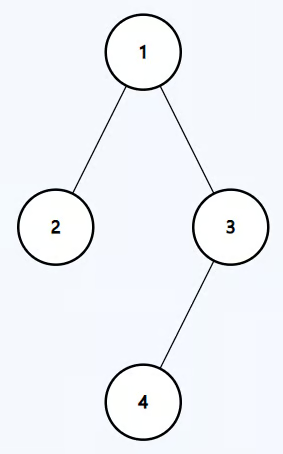

# Maximum Depth of Binary Tree
https://neetcode.io/problems/depth-of-binary-tree/question?list=blind75

## Topics
Tree, Depth-First Search, Breadth-First Search, Binary Tree

## Recommended Time & Space Complexity
You should aim for a solution with O(n) time and O(n) space, where n is the number of nodes in the tree. 

## Solutions
### Solution 1: recurrsive DFS [optimal]
ex:- 

Input: root = [1,2,3,null,null,4]
Output: 3

main idea: using DFS recurrsion

- start with the root
- if its not null, go to the left and right sub tree
- then repeat the same process for the left and right nodes
- increment evertime you go to the next depth
- at the base return the number of times we got the length

#### Complexity
- Time: $O(n)$
- Space: $O(n)$