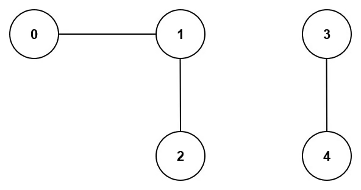

# Number of Connected Components in an Undirected Graph
https://neetcode.io/problems/count-connected-components/question?list=blind75

## Topics
Depth-First Search, Breadth-First Search, Union Find, Graph

## Recommended Time & Space Complexity
You should aim for a solution as good or better than O(V + E) time and O(V + E) space, where V is the number vertices and E is the number of edges in the graph. 

## Solutions
### Solution 1: using union find [optimal]

Input:
n = 5, edges = [[0,1],[1,2],[3,4]]

Output: 2

- we use two arrays, one to hold parents and another to hold rank
- each node will have itelf as a parent
- we then perfom union operation based on if the other parent element is a child of another
- we traverse over the edge list and find the root node, ie the node with most number of children
- we repeat this process until all the edges are traversed
- for each node we attach it into a parent, we decrement the count
- this count will be the number of componenets

#### Complexity
- Time: $O(V + E)$
- Space: $O(V + E)$