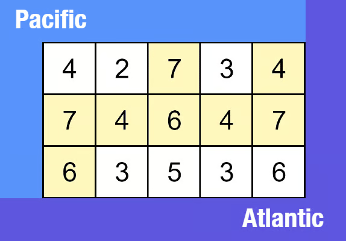

# Pacific Atlantic Water Flow
https://neetcode.io/problems/pacific-atlantic-water-flow/question?list=blind75

## Topics
Array, Depth-First Search, Breadth-First Search, Matrix

## Recommended Time & Space Complexity
You should aim for a solution with O(m * n) time and O(m * n) space, where m is the number of rows and n is the number of columns in the grid. 

## Solutions
### Solution 1: using dfs with a hashmap [optimal]

Input: heights = [
  [4,2,7,3,4],
  [7,4,6,4,7],
  [6,3,5,3,6]
]

Output: [[0,2],[0,4],[1,0],[1,1],[1,2],[1,3],[1,4],[2,0]]

- instead of solving for if the the matrix elements can reach the pacific and atlantic oceans
- we can solve this in the reverse way
- we start from the pacific and atlantic oceans and find all the matrix positions that can be reached from them

- start from the top row and left column matrix elements, as they can reach the pacific ocean
- check if the adjacent elements are greater than or equal to them
- if so it means that those positions can be reached by the pacific
- similiarly do the elements from bottom row and right column
- store the matrix positions for both cases
- return the common matrix positions from both

#### Complexity
- Time: $O(m n)$
- Space: $O(m n)$