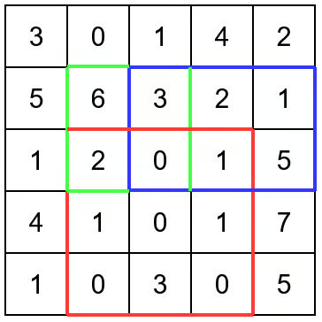

# Range Sum Query 2D Immutable
https://neetcode.io/problems/range-sum-query-2d-immutable/question?list=neetcode250

## Topics:
Array, Design, Matrix, Prefix Sum

## Solutions
### Solution 1: using prefix sum [optimal]

Input: ["NumMatrix", "sumRegion", "sumRegion", "sumRegion"]
[[[[3, 0, 1, 4, 2], [5, 6, 3, 2, 1], [1, 2, 0, 1, 5], [4, 1, 0, 1, 7], [1, 0, 3, 0, 5]]], [2, 1, 4, 3], [1, 1, 2, 2], [1, 2, 2, 4]]

Output: [null, 8, 11, 12]

Explanation:

NumMatrix numMatrix = new NumMatrix([[3, 0, 1, 4, 2], [5, 6, 3, 2, 1], [1, 2, 0, 1, 5], [4, 1, 0, 1, 7], [1, 0, 3, 0, 5]]);
numMatrix.sumRegion(2, 1, 4, 3); // return 8 (i.e sum of the red rectangle)
numMatrix.sumRegion(1, 1, 2, 2); // return 11 (i.e sum of the green rectangle)
numMatrix.sumRegion(1, 2, 2, 4); // return 12 (i.e sum of the blue rectangle)

create prefix sum matrix for the given matrix:
- to find the pre fix sum matrix[i][j], add the elements from matrix[0][0] to matrix[i][j] in the form of a square

returning the sum value for matrix[i1][j1] to matrix[i2][j2]
- substarct the prefix sum value, prefix_matrix[i2][j2] - prefix_matrix[i1][j1]
- add the matrix[i1][j1] to the given sum

#### Complexity
- Time: $O(n)$
- Space: $O(m * n)$