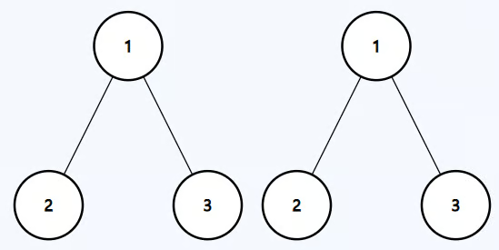

# Same Binary Tree
https://neetcode.io/problems/same-binary-tree/question?list=blind75

## Topics
Tree, Depth-First Search, Breadth-First Search, Binary Tree

## Recommended Time & Space Complexity
You should aim for a solution with O(n) time and O(n) space, where n is the number of nodes in the tree. 

## Solutions
### Solution 1: recurrsive DFS [optimal]

Input: p = [1,2,3], q = [1,2,3]
Output: true

main idea: using DFS recurrsion

- start with the root node
- check if the root node value are equal
- now recurrsively, check the nodes for left subtree
- and then the right subtree
- if all are equal, then it is same
- else they are different

#### Complexity
- Time: $O(n)$
- Space: $O(n)$