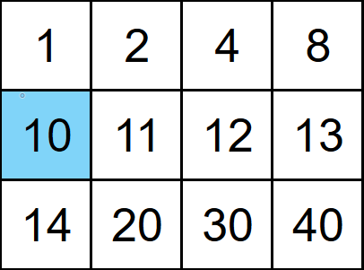

# Search a 2D Matrix
https://neetcode.io/problems/search-2d-matrix/question?list=neetcode150

## Topics:
Arrays, Binary Search, Matrix

## Recommended Time & Space Complexity
You should aim for a solution with O(log(m * n)) time and O(1) space, where m is the number of rows and n is the number of columns in the matrix.
 

## Solutions
### Solution 1: using binary search [optimal approach]
Example 1:

Input: matrix = [[1,2,4,8],[10,11,12,13],[14,20,30,40]], target = 10

Output: true

Output: 3

- we use two binary search
- one is used based on the first element of every row
- this will help us know which row and element is in
- next we take a binary search on that row and return the position

#### Complexity
- Time: $O(\log mn)$
- Space: $O(1)$
