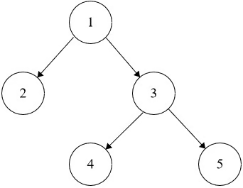

# Serialize and Deserialize Binary Tree
https://neetcode.io/problems/serialize-and-deserialize-binary-tree/question?list=blind75

## Topics
String, Tree, Depth-First Search, Breadth-First Search, Design, Binary Tree

## Recommended Time & Space Complexity
You should aim for a solution with O(n) time and O(n) space, where n is the number of nodes in the given tree. 

## Solutions
### Solution 1: preorder notation [optimal]
ex:- 

Input: root = [1,2,3,null,null,4,5]
Output: [1,2,3,null,null,4,5]

main idea: using preorder to hold the elemets of the tree

- start from the root
- if it is not null, append the value to the string
- then go to the left subtree, and repeat the above process
- then go to the right subtree, and repeat the above process
- else if the Tree Node is null, apppend 'N' and return

- for deserialization, do the above process in reverse
- a sub tree is full if both the left and right nodes are null

#### Complexity
- Time: $O(n)$
- Space: $O(n)$