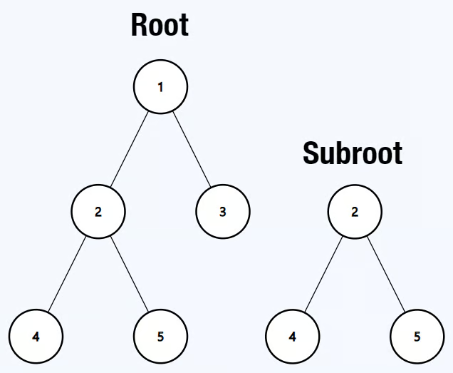

# Same Binary Tree
https://neetcode.io/problems/same-binary-tree/question?list=blind75

## Topics
Tree, Depth-First Search, String Matching, Binary Tree, Hash Function

## Recommended Time & Space Complexity
You should aim for a solution as good or better than O(m * n) time and O(m + n) space, where n and m are the number of nodes in root and subRoot, respectively. 

## Solutions
### Solution 1: recurrsive DFS [optimal]

Input: root = [1,2,3,4,5], subRoot = [2,4,5]
Output: true

main idea: using DFS recurrsion

- start with the first node of root
- check if the root's first node is the same as subRoot
- if they are equal, check if the two trees are equal using a recurrsive function
- if not, go to the left subtree of root and check there
- then check for tht right subtree of root and check there
- do this until all the nodes of root are traversedaaaaa

#### Complexity
- Time: $O(m * n)$
- Space: $O(m + n)$