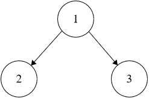

# Valid Binary Search Tree
https://neetcode.io/problems/valid-binary-search-tree/question?list=blind75

## Topics
Tree, Depth-First Search, Binary Tree

## Recommended Time & Space Complexity
You should aim for a solution with O(n) time and O(n) space, where n is the number of nodes in the given tree. 

## Solutions
### Solution 1: DFS [optimal]
ex:- 

output = false

main idea: using Depth First Search

- start with the root node
- check if the left value is smaller than the current
- check if the right value is larger thant he current
- if both are true, go to the left and right subtrees and check them
- else return false
- repeat until you reach the end node, here return true

#### Complexity
- Time: $O(n)$
- Space: $O(n)$