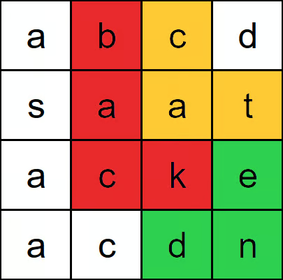

# Word Search II
https://neetcode.io/problems/search-for-word-ii/question?list=blind75

## Topics
Array, String, Backtracking, Trie, Matrix

## Recommended Time & Space Complexity
You should aim for a solution with O(m * n * 4 * (3^(t-1)) + s) time and O(s) space, where m is the number of rows, n is the number of columns, t is the maximum length of any word and s is the sum of the lengths of all the words. 

## Solutions
### Solution 1: implement trie [optimal]

Input:
board = [
  ["a","b","c","d"],
  ["s","a","a","t"],
  ["a","c","k","e"],
  ["a","c","d","n"]
],
words = ["bat","cat","back","backend","stack"]

Output: ["cat","back","backend"]

- implement trie to store the words to find

- traverse the matrix
- take the character at mat[i][j] is in the trie
- if it is not, go to the next character
- if it has, go to each of the neighbours using DFS to see if they are in trie
- do this until the nighbour is in trie and it reaches the leaf node of trie
- this means, that word exists in the table, add it to the list of words
- if not return, and check other neighbours
- repeat the above process until all the characters have been traversed

#### Complexity
- Time: $O(m * n * 3 ^{t - 1} + s)$
- Space: $O(s)$