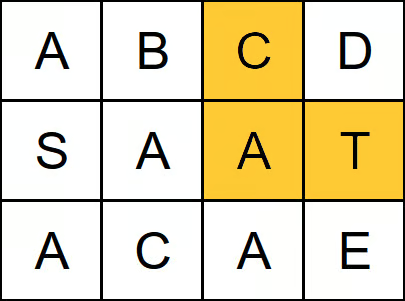

# Word Search
https://neetcode.io/problems/search-for-word/question?list=blind75

## Topics
Array, String, Backtracking, Depth-First Search, Matrix

## Recommended Time & Space Complexity
You should aim for a solution with O(2^(t/m)) time and O(t/m) space, where t is the given target and m is the minimum value in the given array. 

## Solutions
### Solution 1: using backtracking [optimal]

Input: 
board = [
  ["A","B","C","D"],
  ["S","A","A","T"],
  ["A","C","A","E"]
],
word = "CAT"

Output: true

main idea: using backtracking

- using a pointer i to point to the first letter of the word
- start with the first element of the first row
- check if that element is the ith letter
- if so, increment i and seach its adjacent elements are the next character (top, bottom, right and left) recurrsively
- if it is not, go to the next element in the board
- repeat until you finish all the board characters 

#### Complexity
- Time: $O(2^{t/m})$
- Space: $O(t/m)$